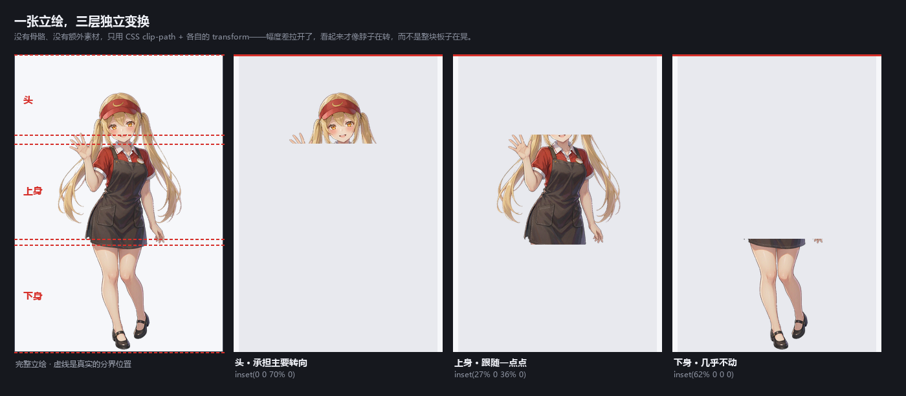
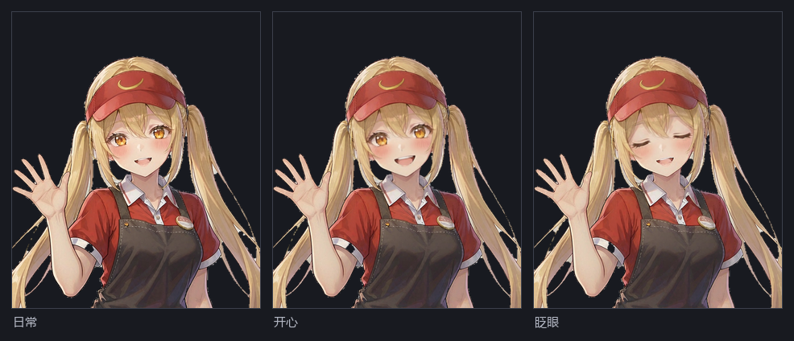
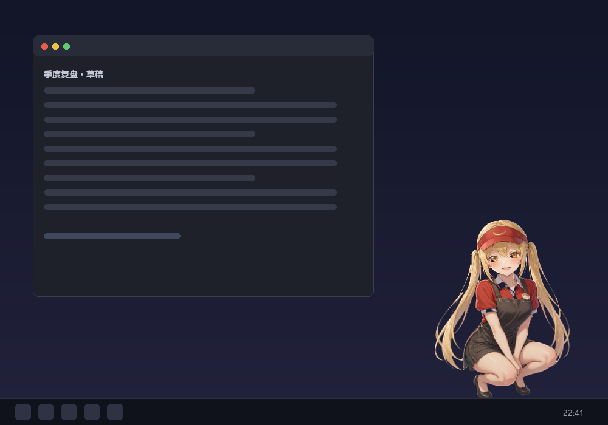
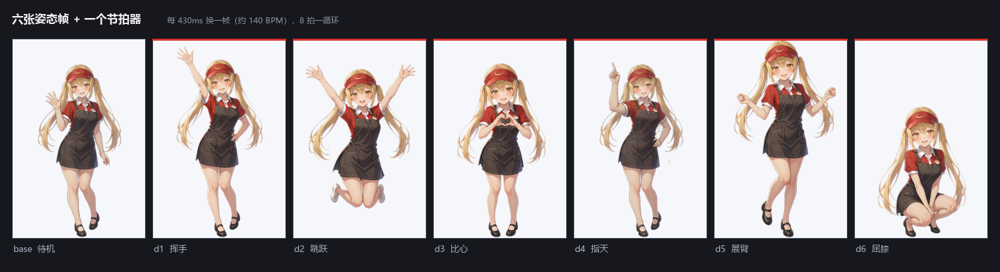
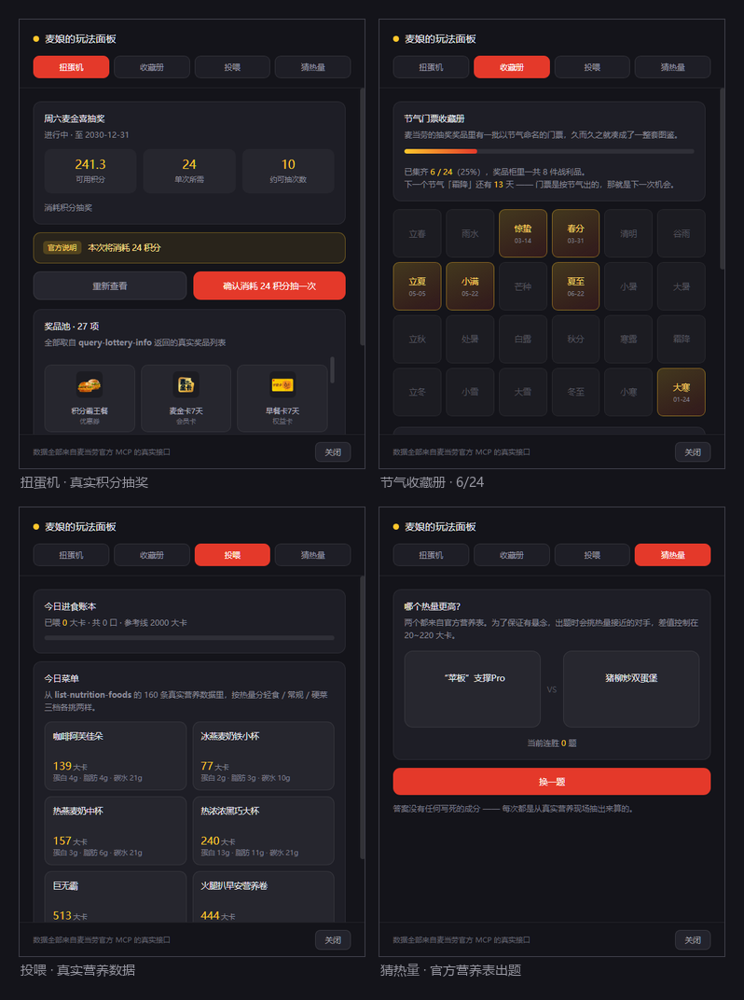
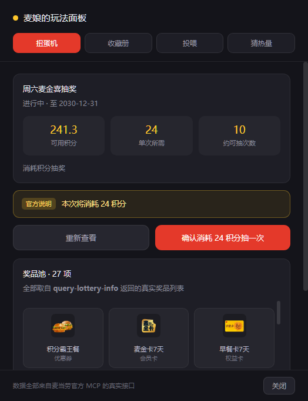
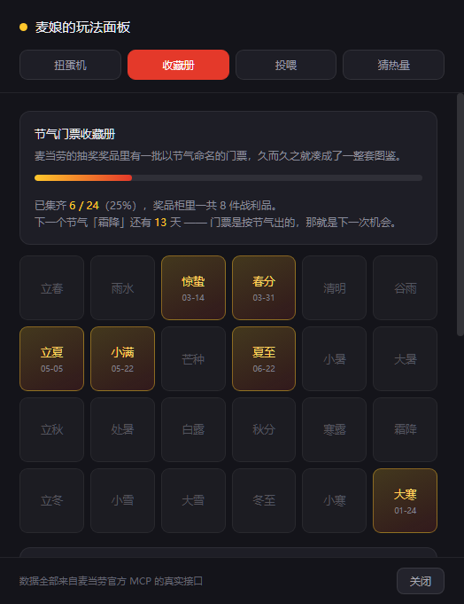
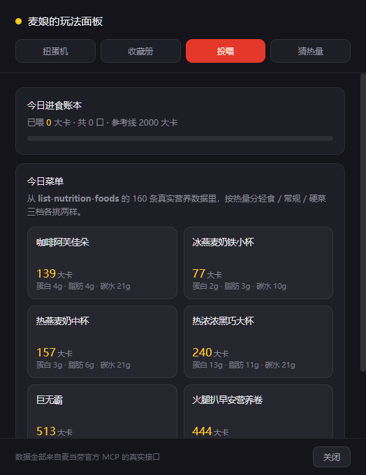
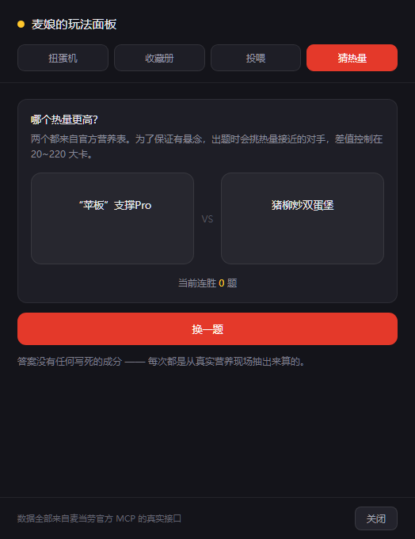
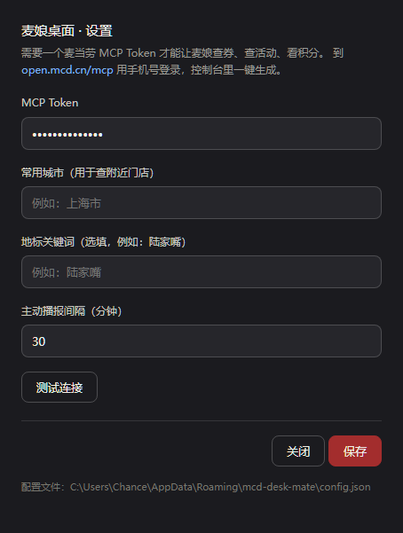

# 麦娘桌面 McDesk


**一个住在你桌面上的二次元麦当劳店员。**

不是聊天框里的问答机器人——是常驻桌面、会呼吸、会眨眼、会转头看你、会在券过期之前先替你急一眼的角色。驱动她的是**麦当劳中国官方 MCP Server** 的真实返回值，不是写死的假数据。

> **验证状态**：已用真实 MCP Token 完成端到端实测——握手成功、`tools/list` 返回 **35 个 Tool**，本项目用到的 **12 个 Tool 全部真实调用通过**。下文所有截图与播报文案均取自真实账号数据的实跑结果。

## 目录

- [她长什么样](#她长什么样)
- [她会跳舞](#她会跳舞)
- [四个玩法](#四个玩法)
- [陪伴感是怎么做出来的](#陪伴感是怎么做出来的)
- [她能做什么](#她能做什么)
- [快速开始](#快速开始)
- [用到的 MCP 能力](#用到的-mcp-能力)
- [技术架构](#技术架构)
- [立绘素材管线](#立绘素材管线)
- [常见问题](#常见问题)
- [合规说明](#合规说明)

## 她长什么样


她会呼吸（整个身体极缓地起伏）、会眨眼（每 2.6~6.8 秒随机一次）、会在你移动鼠标时**转头看着你**。上面这段 GIF 不是另做的宣传动画——它是渲染层真实的注视 + 呼吸循环，由 `scripts/make_showcase.py` 复用 `style.css` 的同一套分层比例导出。

**她怎么做到「转头看你」的？** 一张平面的立绘被切成三层，各自独立变换：



头部承担大部分转向幅度（横向位移 + 视觉压缩），上身只跟一点点，下身几乎不动。**拉开这个幅度差，看起来才像脖子在转，而不是整块板子在晃。**

这是 Live2D 的穷人版：没有骨骼、没有额外素材、没有运行时开销，只用 CSS `clip-path` + 三份 `transform`，就把一张「看向前方的贴纸」变成了「会看着你的角色」。

表情只有三张，但姿态完全对齐，切换时不会跳动：



| 表情 | 触发时机                        |
| -- | --------------------------- |
| 日常 | 默认待机                        |
| 开心 | 领到券、抽中奖品、答对题目、被点击时          |
| 眨眼 | 每 2.6 ~ 6.8 秒随机眨一次；打瞌睡时保持闭眼 |

三张图同时也是三层立绘的共用素材（头 / 上身 / 下身各自裁切同一张图），所以换表情时三层会同步切换，**不会出现「头笑身不笑」**。

### 她不会挡你干活



*右侧是她，左侧是你本来在用的窗口。气泡里是真实的券到期提醒，头顶的红色感叹号也是她真实的情绪状态。*

她的窗口虽然是个 320×600 的矩形，但**只有压在角色身上的那部分才接管鼠标**，其余区域点击直接穿透到下层应用——你可以照常拖动、框选、写文档。

## 她会跳舞


**双击她**就会跳一段（8 拍一循环，跳 3 轮），节拍约 140 BPM，收势还会轻轻顿一下。

### 为什么舞蹈必须换素材

分层 `transform` 能做呼吸、倾斜、Q 弹、拖拽惯性——但它们全都是**同一张画的形变**。抬手、扭腰、屈膝、腾空改变的是**画本身**：没有哪组仿射变换能把一只垂着的手臂变成举起来的。

所以舞蹈只能靠**按节拍换整套关键帧**：



六张姿态帧（挥手 / 跳跃 / 比心 / 指天 / 展臂 / 屈膝）加上一个节拍器，每拍换帧并叠一次力度脉冲（下蹲拍往下沉、跳跃拍往上窜）。**姿态给了造型，节拍给了动能。**

上面这张图里的七帧，站位、取景、地面线完全一致，只有姿态在变——让六张分别生成的图做到这一点，是本项目最费劲的地方，过程记在[立绘素材管线](#立绘素材管线)里。

## 四个玩法



四个玩法全部长在 MCP 的真实返回值上——不是为了「有趣」而凭空加动画，而是先通读 Tool schema，再倒推有趣的东西。

### 扭蛋机 · 用真实的麦当劳积分抽奖



麦当劳 MCP 提供了真实的积分抽奖接口，McDesk 把它做成了一台扭蛋机。

**关键在于它经得起较真**——官方协议对 `draw-lottery` 有硬性约束，本项目逐条落实：

| 官方要求                                      | 实现                                              |
| ----------------------------------------- | ----------------------------------------------- |
| 调用前必须展示 `drawDecision.nextConsumption` 原文 | 界面用醒目的黄色警示条**原样呈现**「本次将消耗 24 积分」，不做任何改写         |
| 必须得到用户明确确认                                | 按钮文案就是实际代价：**「确认消耗 24 积分抽一次」**。确认按钮与查询按钮是两个独立动作 |
| `resourceEligible` 为 false 时不得调用          | 抽前**重新查一次**活动状态，积分不足直接拒绝，不用本地余额推算               |
| 严禁试抽、自动抽、连续抽                              | 没有任何自动触发路径；抽后进入 8 秒冷却，失败也计入——避免把服务端限流变成用户的积分损失  |
| 失败时 `status.message` 须原样展示                | 直接透传服务端文案，不包装、不改写                               |

程序内也不给「一键连抽」留任何入口。抽奖是会真实扣除用户积分的操作，**宁可少一点爽感，也不能让用户在不知情的情况下花掉积分**。

### 节气收藏册 · 从真实数据里长出来的图鉴



实测发现「周六麦金喜抽奖」的奖品中有一类「门票」，名称恰好是二十四节气——于是奖品墙天然构成一套可收集的图鉴，**不需要任何额外配置，也不需要我编造素材**。

金色格子是已收集（带真实获得日期），灰色是还差着的。面板还会算出**下一个节气还有几天**——门票按节气出，那就是下一次机会。

> 这个彩蛋没法被复制：别人 fork 了代码，也不会有你账号里那几张历史门票。

### 投喂 · 160 条官方营养数据变成了她的体重



`list-nutrition-foods` 本来只能「查个数字告诉你」，McDesk 把它做成了投喂玩法：从真实营养表里按热量分轻食 / 常规 / 硬菜三档各挑两样，喂给她看她什么反应。

她**记得今天吃了多少**（进程内账本，跨零点自动归零）：超过 1200 大卡开始嘀咕，过了 2000 就抱怨跑不动了。

### 猜热量 · 用真实数据出题



从 160 条官方营养数据里现场抽题。**出题策略决定题目质量**——完全随机会抽出「红茶 vs 双层汉堡」这种常识题，所以先把库按热量排序，再在邻近区间找对手，差距锁在 20~220 大卡：

```
差 24 大卡 | A: 那么大鸡排(385)      B: 大脆鸡扒麦满分(361)
差 26 大卡 | A: 猪柳炒双蛋堡(437)    B: 专"薯鱼"你(463)
```

答案没有任何写死的成分，每次都是现算的。

## 陪伴感是怎么做出来的

桌宠的价值不在功能，在**陪伴感**——而陪伴感的来源可以被拆解和工程化。McDesk 具体做了四件事。

### 1. 她看得见你

移动鼠标，她的头会朝你转过来（见[她长什么样](#她长什么样)）。头部与上身用**幅度差**制造伪 3D 透视：头转得多、上身跟得少，这个差值就是「有脖子」的感觉。

### 2. 她有重量

拖拽时身体按横向速度**反向倾斜**，速度衰减后自动回正；松手时施加一次按落速度计算的挤压脉冲，再由弹簧阻尼器把它变成过冲——这一晃就是「Q 弹」的来源。甩得太猛她会喊头晕。

**刚体平移一眼就穿帮，有惯性的东西才像真的存在。**

### 3. 她在你没理她的时候也有戏

东张西望、哼歌（♪ 飘出来）、伸懒腰、点头——每 7~18 秒随机挑一个。**如果她只在被点击时才有反应，本质上还是一张贴图。**

连续 **75 秒**没有任何交互，她会垂下头、闭上眼、开始飘 `z`，呼吸节奏也放慢一倍。你一动鼠标她就惊醒——「啊——我、我才没睡着呢！」

### 4. 她的情绪来自真实数据

不是随机播放的开心动画：**券今天到期她会顶着红色感叹号、把气泡转成警示橙**；节气临近会提醒你去看门票；深夜会劝你（或者假装没看见）夜宵。这些全部由 MCP 的真实返回值驱动。

## 她能做什么

**玩法**（右键她 → 直接进入）

| 玩法       | 用到的 MCP 能力                            |
| -------- | ------------------------------------- |
| 🎰 扭蛋机抽奖 | `query-lottery-info` + `draw-lottery` |
| 🎫 节气收藏册 | `query-my-prizes`                     |
| 🍔 投喂麦娘  | `list-nutrition-foods`                |
| 🎯 猜热量   | `list-nutrition-foods`                |

（菜单文案与应用内右键菜单完全一致。）

**业务动作**

| 动作    | 入口             | 说明                                |
| ----- | -------------- | --------------------------------- |
| 汇报近况  | 启动自动 / 托盘 / 右键 | 按紧急度播报最值得说的一件事                    |
| 一键领券  | 托盘 / 右键        | 调用 `auto-bind-coupons` 领取麦麦省全部可用券 |
| 查看我的券 | 托盘 / 右键        | 盘点已有券；**有券今日到期会优先警示**             |
| 今日活动  | 托盘 / 右键        | 查询当月活动日历并点名今日上线活动                 |
| 我的积分  | 托盘 / 右键        | 播报可用与累计积分，单独提示即将过期部分              |
| 最近订单  | 托盘 / 右键        | 播报上一单时间、门店、金额、商品与距今天数             |
| 附近门店  | 托盘 / 右键        | 按常用城市 + 关键词查询最近餐厅与营业状态            |
| 营养速查  | 程序内调用          | 在 160 条官方营养数据中检索热量与三大营养素          |

**与她互动**

| 操作        | 反应                          |
| --------- | --------------------------- |
| 左键单击      | 她被戳一下，身体抖一抖，随机说句话           |
| **双击**    | **跳一段舞**（8 拍一循环 ×3，中途拎起她会停） |
| 按住拖动      | 跟着你的手倾斜，松手 Q 弹回正；甩太猛会喊头晕    |
| 移动鼠标      | **她会转头看着你**                 |
| 放着不管 75 秒 | 打瞌睡，飘 `z`；一动鼠标就惊醒           |
| 右键        | 打开完整菜单                      |

### 实测输出

以下是真实 Token 跑出来的播报结果（`node scripts/check-brain.js`）：

```
=== 定时播报 ===
「巧克力味厚松饼猪柳蛋套餐」今天就要到期了，趁着还没过期去用掉呀！

▶ 积分   你现在有 241.3 麦享会积分，累计攒过 313.3。
▶ 活动   今天上线的是「韩式风味蘸酱上新」等 15 个活动。
▶ 订单   最近一单是 2026-06-22 在麦当劳上海××餐厅，花了 31.9 元，
         买了世界波犇牛堡两件套、世界波犇牛堡。那是 109 天前的事啦。
▶ 门店   最近的是「麦当劳上海陆家嘴明珠环餐厅」，营业时间 07:00-23:00。
▶ 营养   巨无霸：513 大卡，蛋白质 27g，脂肪 26g，碳水 42g，钠 961mg。
```

（文中金额、门店与积分均为真实返回值的展示样例。）

## 快速开始

### 1. 申请麦当劳 MCP Token

访问 [open.mcd.cn/mcp](https://open.mcd.cn/mcp)，用手机号登录 → 右上角「控制台」→ 点击「激活」→ 同意服务协议 → 复制 Token。**全程约两分钟，无需审核。**

### 2. 安装依赖并启动

```bash
git clone https://github.com/<your-name>/mcd-desk-mate.git
cd mcd-desk-mate
npm install
npm start
```

> 若 `npm install` 卡在下载 Electron 二进制，可先设置镜像：  
> `ELECTRON_MIRROR=https://npmmirror.com/mirrors/electron/ npm install`

### 3. 填入 Token

麦娘启动后会提示你配置。**在角色身上点右键 → 「设置 MCP Token…」**，粘贴 Token，点「测试连接」确认可用（会显示服务器返回的工具数量），再保存。



顺便把「常用城市」填上，否则「附近门店」查不了。Token 保存在本机 `%APPDATA%/mcd-desk-mate/config.json`，不会上传到任何地方。也可以用环境变量 `MCD_MCP_TOKEN` 直接注入。

### 4. 开始使用

配置完成后麦娘会立刻拉一次数据并开口汇报。之后：

- **左键单击**她 → 随机说句话
- **双击**她 → 跳一段舞
- **按住拖动** → 换个位置
- **右键** → 打开功能菜单（汇报、领券、我的券、今日活动、积分、订单、附近门店、玩法、设置）

### 配置项

在设置窗口或 `config.json` 中可调整：

| 键               | 默认值     | 说明                                        |
| --------------- | ------- | ----------------------------------------- |
| `token`         | —       | 麦当劳 MCP Token（也可用环境变量 `MCD_MCP_TOKEN` 注入） |
| `city`          | —       | 常用城市，如「上海市」。**查询附近门店时必填**                 |
| `address`       | —       | 地标关键词（选填），如「陆家嘴」                          |
| `briefInterval` | `30`    | 主动播报间隔（分钟），最小 5                           |
| `muted`         | `false` | 暂停主动播报                                    |
| `autoLaunch`    | `false` | 开机自动启动                                    |

## 用到的 MCP 能力

本项目调用麦当劳中国官方 MCP Server（`https://mcp.mcd.cn`，Streamable HTTP 协议），服务器共提供 35 个 Tool，**本项目实际使用其中 12 个**：

**账户与资产**  
`query-my-coupons` · `available-coupons` · `auto-bind-coupons` · `query-my-account` · `order-list`

**营销与门店**  
`campaign-calendar` · `query-nearby-stores` · `now-time-info`

**营养**  
`list-nutrition-foods`

**抽奖与奖品**  
`query-lottery-info` · `draw-lottery` · `query-my-prizes`

完整的调用流程、并发策略、**实测响应格式分析**、抽奖合规设计与容错设计见 [MCP\_INTEGRATION.md](./MCP_INTEGRATION.md)。

自行验证真实调用：

```bash
export MCD_MCP_TOKEN="你的 Token"
node scripts/verify-mcp.js list                              # 列出全部 35 个 Tool
node scripts/verify-mcp.js calls scripts/verify-calls.json   # 真实调用并打印原始响应
node scripts/check-brain.js 上海市 陆家嘴                     # 端到端跑一遍麦娘播报
node scripts/check-fun.js                                    # 玩法能力联调（只读，不会抽奖）
```

> `check-fun.js` 刻意不调用真实的 `draw-lottery`——抽奖会实实在在扣积分。  
> 它只验证「不做确认时必定被拒绝」这道闸门是有效的。

## 技术架构

```
主进程 (Node)                          渲染进程 (浏览器环境)
├─ 窗口 / 托盘 / 原生菜单              ├─ 三层立绘（头/身/腿）独立变换
├─ 鼠标穿透调度                        ├─ 注视 / 惯性 / 弹簧 物理循环
├─ MCP 客户端（自研，无第三方 SDK）    ├─ alpha 命中检测（决定是否接管鼠标）
├─ 响应解析层 parse.js       ◄─ IPC ─► ├─ Idle 行为池 / 打瞌睡
├─ PetBrain 业务层（含抽奖闸门）       ├─ 对话气泡 / 情绪粒子
└─ 玩法面板窗口（独立 BrowserWindow）  └─ 表情切换 / 舞蹈编排
```

**四个值得一提的实现细节：**

1. **鼠标穿透**：窗口默认 `setIgnoreMouseEvents(true, {forward: true})`，桌面点击会穿透到下层应用。渲染层把立绘降采样成一张 alpha 掩码，实时判断指针是否真的落在角色不透明像素上，只有压到角色身上才申请接管鼠标——这样窗口虽然是个 320×600 的矩形，却完全不影响你操作被它覆盖的区域。

   `forward: true` 还有个副作用是好事：即便窗口不接管鼠标，`mousemove` 依然会转发进来，**注视跟随因此不需要主进程轮询全局鼠标位置**。
2. **零第三方 MCP 依赖**：`src/mcp/client.js` 用约 180 行实现了 MCP 客户端。桌面宠物对启动速度和安装体积敏感，引入完整 SDK 不划算；同时需要处理 `application/json` 与 `text/event-stream` 两种响应形态，以及 401 / 429 / 超时的中文兜底提示。
3. **独立响应解析层**：这是踩坑之后才补上的一层。麦当劳 MCP 的 Tool 返回的是 **Markdown 文本**，而不是结构化 JSON，且存在三种形态——纯 Markdown 报告、Markdown + 末尾内嵌 JSON、以及营养接口那种「内嵌 JSON 里再套自定义表格串」。最初的实现直接用字段名取值，结果所有数字都静默变成 0。`src/mcp/parse.js` 用「括号配平 + 字符串状态机」挖出内嵌 JSON，用正则解析 Markdown 报告，再把营养表的 160 条记录还原成结构化数组；任一段失配只降级为空集合，绝不抛异常。详见 [MCP\_INTEGRATION.md 第 3 节](./MCP_INTEGRATION.md)。
4. **动画与物理分层，不争同一个 transform**：CSS 的 `animation` 会覆盖 inline `transform`。所以呼吸动画挂在 `#pet-breathe` 上，物理量（倾斜/抬升/挤压）挂在 `#pet-wrap` 上，注视挂在各层 `img` 上——三个独立的 DOM 层级，互不干扰。一个 `requestAnimationFrame` 循环驱动全部弹簧积分，没有 CSS 与 JS 争抢属性的问题。

## 立绘素材管线

六张姿态帧是分别生成的，取景远近并不一致——有的像特写，有的像远景，缩放差距最高到 **1.5 倍**。如果直接切帧，每换一张整个人就平移 + 缩放一下，**看起来像信号不良，而不是跳舞**。

所以 `scripts/prepare_dance.py` 会先把九帧（含待机三表情）归一到同一坐标系：

| 维度 | 锚点                | 为什么不能用别的                                                         |
| -- | ----------------- | ---------------------------------------------------------------- |
| 水平 | 红色鸭舌帽的质心          | 包围盒会被挥手的手臂、垂下的双马尾撑歪；也不能取「最上面的红像素」——d1 在 y=40 有个孤立噪点，会把锚点算偏 200px |
| 垂直 | 黑色玛丽珍鞋的鞋底         | 所有帧的脚踩同一条地面线，切帧时人才是钉在地上的                                         |
| 尺度 | 目视标定 + alpha 轮廓测量 | 红色阈值在不同渲染下抓到的范围不一致（偏差 25%），「帽→鞋高」又是姿态相关的（下蹲/跳跃本来就会压低它）           |

跳跃帧是唯一的例外：原图里她的腿是向后折起的，若把鞋底直接压到地面线，读起来是**跪着**而不是跳起来。所以它改按「头顶对齐站立高度」来定垂直位置——折起的腿把脚自然抬高，正是腾空该有的样子。这个偏移量写进 `assets/dance.json` 交给编排层。

**管线里踩过的坑：**

- **「透明背景」是假的**：模型会把棋盘格纹理直接画进像素（浅格 `(249,246,243)`、深格 `(229,225,222)`），单一底色 flood fill 会把眼白和制服白边一起吃掉。
- **封闭口袋**：垂下来的双马尾常与身体围出一个封闭缝隙，边缘连通填充够不到它，于是深色桌面上就留着一块棋盘格。判据是：待判区域只要**同时含有棋盘格的深格像素**，它就属于背景——眼白和白边都是单一浅色，不含深格。
- **两种背景形态**：新生成的三帧是一整块均匀底色 `(216,211,201)`，最暗通道 199 落在亮色键下限 200 之下，亮度阈值会漏一大片。所以纯色背景改走「与取样底色的最大通道差」判据。
- **水印**：模型在右下角打了水印，压在纯背景上、颜色只差一点点，抠图既键不掉又不像角色。实测该矩形内没有任何角色像素，直接填回背景色。
- **有的帧根本不能用**：原 d4 把脚裁断在画幅边界上（「鞋底」测到的其实是边界），按脚对齐会变矮人、按头对齐会浮空。**与其在错误的素材上反复凑，不如重画一张。**

> 另一个更根本的教训：原来的待机立绘是「头到裙摆」的半身特写，画面里**根本没有脚**，和全身的舞蹈帧不可能共用地面线——所以三个待机表情也按全身取景重新生成了。

## 目录结构

```
mcd-desk-mate/
├─ src/
│  ├─ main/
│  │  ├─ index.js        窗口、托盘、菜单、定时播报、玩法面板窗口
│  │  └─ preload.js      IPC 白名单桥接
│  ├─ mcp/
│  │  ├─ client.js       MCP Streamable HTTP 客户端
│  │  ├─ parse.js        Markdown / 内嵌 JSON / 表格串 三形态解析
│  │  └─ brain.js        业务封装、播报文案、抽奖闸门、节气图鉴
│  └─ renderer/
│     ├─ index.html      桌宠主界面（三层立绘结构）
│     ├─ style.css       分层变换、物理、粒子、气泡样式
│     ├─ pet.js          注视 / 物理 / Idle 池 / 打瞌睡 / 舞蹈编排 / 命中检测
│     ├─ panel.html      玩法面板（扭蛋机 / 收藏册 / 投喂 / 猜热量）
│     ├─ panel.css
│     ├─ panel.js
│     ├─ settings.html   设置窗口
│     └─ settings.js
├─ assets/               立绘素材（透明 PNG，九帧统一坐标系）
│  ├─ dance.json         各帧的对齐元数据（离地高度等）
│  └─ raw/               AI 生成的原始立绘
├─ scripts/
│  ├─ cutout.py          立绘抠图、封闭口袋补洞、边缘去污、水印清除
│  ├─ prepare_dance.py   舞蹈帧管线：抠图 → 尺度归一 → 锚点对齐 → 合成
│  ├─ make_showcase.py   生成本 README 的全部图片与 GIF
│  ├─ verify-mcp.js      真实 MCP 调用验证器
│  ├─ verify-calls.json  验证用调用清单
│  ├─ check-brain.js     端到端播报校验
│  └─ check-fun.js       玩法能力联调（只读，不触发抽奖）
├─ docs/                 README 展示素材
├─ CONTEST_DECLARATION.md
├─ MCP_INTEGRATION.md
└─ mcp-config.example.json
```


```

> 开发期的 `MCD_SELFTEST=<毫秒>` 冒烟模式仍然保留：启动后自动截图并退出，便于验证渲染结果。加 `MCD_SELFTEST_PANEL=gacha|collection|feed|quiz` 可一并截取玩法面板；加 `MCD_SELFTEST_DANCE=1` 会触发一段舞并按节拍连拍，用来验证换帧链路。

## 常见问题

**角色显示成黑块或闪烁？**
部分显卡驱动在「透明窗口 + 硬件加速」下会有问题，用 `MCD_DISABLE_GPU=1 npm start` 退回软件渲染。

**她一直不说话？**
检查 Token 是否配置成功（右键 → 设置 → 测试连接）。如果 `muted` 被打开，主动播报也会暂停。也可以用环境变量直接注入：`MCD_MCP_TOKEN=xxx npm start`。

**「附近门店」提示没找到门店？**
麦当劳 `query-nearby-stores` 在账号没有收藏餐厅时**必须同时提供城市与关键词**，否则服务端会返回 `600050`。在设置里填上「常用城市」（如 `上海市`）即可。

**数字都是 0 / 播报像是没读到数据？**
先确认 Token 有效；若仍异常，执行 `node scripts/check-brain.js 上海市` 观察原始返回——该脚本会打印每一步的真实数据与解析结果。MCP 返回的是 Markdown 文本，不同 Tool 形态不同，解析层已做兼容，但服务端若调整格式需要同步更新 `src/mcp/parse.js`。

**提示 429？**
MCP 限流为每 Token 每分钟 600 次。调大播报间隔即可。

**扭蛋机点不动 / 说抽不了？**
能不能抽以服务端的 `drawDecision.resourceEligible` 为准。积分不足、活动未开始或已结束时，界面会如实告知而不是把按钮藏起来。刚抽过一次会有 8 秒冷却——这是为了避免短时间内重复调用触发服务端限流（虽然限流不会扣积分，但失败重试的体验很差）。

**抽奖真的会扣积分吗？**
会。所以界面上的按钮文案写的就是实际代价，而且必须由你亲手点确认。**程序不会自动抽、不会连抽，也不会替你决定。**

**素材是怎么来的？**
角色为原创生成形象，未使用麦当劳商标或官方视觉资产。原始立绘在 `assets/raw/`，`scripts/cutout.py` 与 `scripts/prepare_dance.py` 负责把模型输出的背景处理成透明 PNG 并归一到统一坐标系。README 里的全部图片与 GIF 均由 `scripts/make_showcase.py` 生成，其中 `life.gif` 的图层裁剪比例与 `style.css` 的 `clip-path` 保持一致，`dance.gif` 是应用真实运行时按节拍截下来的窗口——**素材展示的就是应用里真实的样子**，不是另做一版宣传动画。

## 目标用户

- 每周都要点几次麦当劳、但总是忘记用券的人
- 想让桌面好看一点、又不喜欢满屏挂件的人
- 想在桌面上养个角色，但不想让它挡住任何操作的人

## 合规说明

- 本项目为麦当劳程序员创意开发大赛参赛作品，由参赛者独立开发，**非麦当劳官方产品**
- 输出内容仅供参考，不构成医疗、营养或其他专业建议；餐品信息、价格及供应状态以麦当劳官方渠道实时结果为准
- 仓库中不含任何真实 Token、密钥或他人个人信息
- 详见 [CONTEST_DECLARATION.md](./CONTEST_DECLARATION.md)

## License

[MIT](./LICENSE) —— 自由使用、修改、分发，只需保留版权与许可声明。

中文摘要（以英文正文为准）：特此免费授予任何人获得本软件及相关文档文件副本的许可，可无限制地使用、复制、修改、合并、出版、发行、再许可和/或销售本软件副本，但须包含上述版权声明与许可声明。本软件按「原样」提供，不作任何担保。

**素材授权**：`assets/` 与 `docs/` 下的立绘素材同样适用本 MIT 许可。角色形象为独立原创设计，未使用麦当劳商标或官方视觉资产，与麦当劳官方无关。
